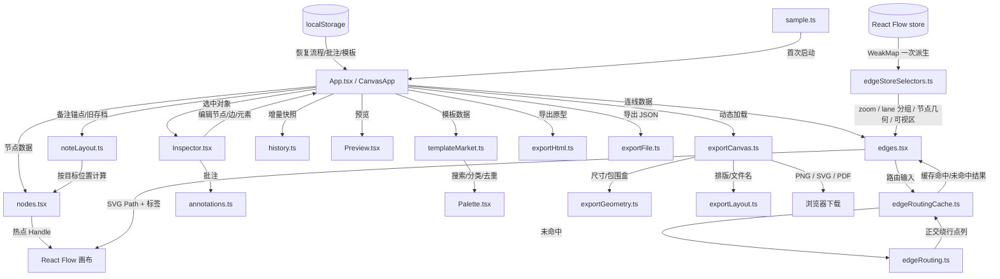

# FlowCraft 项目导航图

> 面向开发和维护的“找东西”索引。产品说明看 [README.md](./README.md)。
> 最后更新：2026-11-01

## 1. 项目速览

- 技术栈：React 19 + TypeScript + `@xyflow/react` + Vite
- 入口：`src/main.tsx` → `src/App.tsx`
- 数据：流程、批注和自定义模板存 `localStorage`，同时支持 JSON 导入/导出
- 开发：`npm run dev -- --port 5177`
- 构建：`npm run build`
- 测试：`npm test`
- 检查：`npm run lint`
- Git 仓库：已初始化（`master`），改动前后各提交一次即可回滚

## 2. 目录与模块

```text
flowcraft/
├─ src/
│  ├─ main.tsx                 应用启动（刻意不启用 StrictMode）
│  ├─ App.tsx                  工作台、画布状态、快捷键、导入导出、批注/模板接线
│  ├─ index.css                全局样式、编辑器、批注与模板市场样式
│  ├─ App.css                  Vite 模板残留样式（当前应用未引用）
│  └─ flow/
│     ├─ types.ts              核心数据结构（含备注锚点 NoteAnchor）
│     ├─ sample.ts             电商示例 8 个界面 / 12 个节点 / 14 条连线
│     ├─ nodes.tsx             Screen / Decision / Action / Note 节点渲染（备注为矩形说明卡）
│     ├─ Icon.tsx              13 类界面元素图标
│     ├─ Palette.tsx           模板市场、搜索/分类、模板导入导出、节点面板
│     ├─ Inspector.tsx         节点/连线/元素编辑、连线热点与走向、批注面板
│     ├─ ScreenView.tsx        画布内高保真界面渲染与走查交互
│     ├─ Preview.tsx           全屏原型预览播放器
│     ├─ edges.tsx             自定义 FlowEdge：标签、回边平衡、手动通道、避障接入
│     ├─ edgeRouting.ts        纯几何避障路由：AABB + 压缩网格 A* + 回边平衡
│     ├─ edgeRoutingCache.ts   有界 LRU 边路由缓存（默认 2048 条）
│     ├─ edgeStoreSelectors.ts 边共享派生状态：zoom / lane 分组 / 节点几何 / 可视区（WeakMap 记忆）
│     ├─ benchGraph.ts         性能基线合成大图（?bench=small|medium|large）+ 页内 FPS/DOM 指标
│     ├─ noteLayout.ts         备注锚定、旧存档迁移、布局重算与级联删除
│     ├─ annotations.ts        批注数据模型、校验、增删改、解析与统计
│     ├─ templateMarket.ts     模板校验、分类、搜索、去重合并、Bundle 导入导出
│     ├─ exportFile.ts         JSON / HTML 文本下载
│     ├─ exportHtml.ts         单文件 HTML 原型导出
│     ├─ exportCanvas.ts       PNG / SVG / PDF 画布导出
│     ├─ exportTypes.ts        画布导出选项与结果类型
│     ├─ exportGeometry.ts     节点尺寸解析与导出包围盒
│     ├─ exportLayout.ts       视口适配、PDF 排版、文件名
│     └─ history.ts            增量撤销/重做快照
├─ tests/                      9 个 Node 测试文件（几何、缓存、导出、批注、模板、备注布局、基准图）
├─ docs/                       README 截图、示例原型与性能基线记录
├─ public/                     favicon 与图标资源
└─ .ego-edge-routing-qa-20261101/  连线路由复测脚本（3 个）
```

## 3. 运行时数据流



## 4. 核心功能索引

### 节点系统

| 你要找什么 | 文件 | 关键符号 |
| --- | --- | --- |
| 数据结构 | `src/flow/types.ts` | `ScreenData`、`ScreenElement`、`ScreenTemplate` |
| 节点外观 | `src/flow/nodes.tsx` | `ScreenNode`、`DecisionNode`、`ActionNode`、`NoteNode` |
| 备注锚定与迁移 | `src/flow/noteLayout.ts` | `noteAnchorFor`、`anchorNotePosition`、`migrateLegacyNoteAnchors`、`layoutAnchoredNotes`、`cascadeDeleteNode` |
| 初始示例 | `src/flow/sample.ts` | `initialNodes`、`initialEdges`、`screenTemplates` |
| 左侧面板/模板市场 | `src/flow/Palette.tsx` | `Palette`、搜索、分类、导入/导出 |
| 属性编辑/批注 | `src/flow/Inspector.tsx` | `Inspector`、`AnnotationPanel` |

### 连线系统（P0-1 已完成）

| 你要找什么 | 文件 | 关键符号 |
| --- | --- | --- |
| 边组件 | `src/flow/edges.tsx` | `FlowEdge`、`roundedPath`、`pointOnPolyline` |
| 几何碰撞 | `src/flow/edgeRouting.ts` | `getNodeBox`、`lineIntersectsBox`、`detectCollisions` |
| 正交避障 | `src/flow/edgeRouting.ts` | `smartEdgeRoute`、`routeAroundNodes` |
| 自动回边平衡 | `src/flow/edgeRouting.ts` | `createBalancedBackEdgePath` |
| 手动回边通道 | `src/flow/edgeRouting.ts` | `createBackEdgeLanePath`、`normalizeEdgeRouteMode` |
| 连线二次编辑 | `src/flow/Inspector.tsx` / `App.tsx` | 出发热点、`routeMode`、`patchEdge` |
| 路由缓存 | `src/flow/edgeRoutingCache.ts` | `createEdgeRouteCache`、`routeWithCache`、`defaultEdgeRouteCache` |
| 边共享派生状态 | `src/flow/edgeStoreSelectors.ts` | `deriveEdgeFlowState`、`selectDerivedEdgeFlowState`、`laneGroupForEdge`、`laneIndexOfEdge` |
| 回归测试 | `tests/edgeRouting.test.ts`、`tests/edgeRoutingCache.test.ts`、`tests/edgeStoreSelectors.test.ts` | 单障碍、多障碍、缓存失效、LRU 淘汰、lane 分组与逐边旧语义等价、派生缓存命中 |

实现要点：

1. `edges.tsx` 通过 `selectDerivedEdgeFlowState` 取共享派生状态：zustand 每次更新产生新 state 对象，`deriveEdgeFlowState` 结果按该对象存 WeakMap，同一帧内所有边共用一次派生（节点几何 O(N)、lane 分组 O(E log E)、可视区、对端标签尺寸数组）；每边只做 Map/O(1) 查询，取代旧版每边 5 个 store selector 的 O(E×N) 扫描。
2. 排除连线的 source/target 节点，其余节点按 22px 安全边距生成 AABB（`derived.avoidRects(excludeNodeId)` 按目标节点记忆化）。
3. 直线无碰撞时继续使用 `getSmoothStepPath`，保持原有观感。
4. 直线有碰撞时，以起点、终点及所有障碍边界组成压缩网格，用带转向惩罚的 A* 找正交路径。
5. 多障碍仍无解时，使用所有障碍并集外框的保守绕行兜底。
6. 自动回边使用 `createBalancedBackEdgePath`：同列/近列且上下相邻的短闭环走局部下通道，把小回路和主流程分开；其余远距离回退保持 A* 最短避障，避免旧版全局底部绕行。
7. 折线路径用圆角拐弯渲染；主边使用自定义终点箭头，默认降低文字噪声，选中连线后才显示文字标签与目标 chip。
8. 非局部通道的回边和前向边通过 `routeWithCache` 复用结果；键包含端点、节点几何、排除节点、边距。

### 批注（P2 已完成）

| 能力 | 文件 / 符号 |
| --- | --- |
| 数据模型、校验、增删改 | `src/flow/annotations.ts` / `Annotation`、`createAnnotation`、`updateAnnotation`、`deleteAnnotation` |
| 解析与统计 | `src/flow/annotations.ts` / `parseAnnotations`、`getAnnotationStats` |
| 节点/连线批注面板 | `src/flow/Inspector.tsx` / `AnnotationPanel` |
| 本地持久化 | `App.tsx` / `ANNOTATION_STORAGE_KEY` |
| JSON 导出 | `App.tsx` / `version: 2` + `annotations` |
| 关联清理 | 删除节点/连线/热点时同步删除批注 |

### 模板市场（P2 已完成，当前为本地模板库）

| 能力 | 文件 / 符号 |
| --- | --- |
| 模板校验与深拷贝 | `src/flow/templateMarket.ts` / `validateTemplate`、`normalizeTemplate`、`cloneTemplateForInsert` |
| 搜索与分类 | `src/flow/templateMarket.ts` / `filterTemplates`、`templateCategory` |
| 去重合并 | `src/flow/templateMarket.ts` / `mergeTemplates` |
| 导入/导出 | `src/flow/templateMarket.ts` / `buildTemplateBundle`、`parseTemplateBundle` |
| 面板交互 | `src/flow/Palette.tsx` / 搜索、分类、导入、导出、空态 |
| 本地持久化 | `App.tsx` / `TEMPLATE_STORAGE_KEY` |

### 导出

| 能力 | 文件 / 符号 |
| --- | --- |
| PNG / SVG / PDF | `src/flow/exportCanvas.ts` / `exportCanvas` |
| 导出类型 | `src/flow/exportTypes.ts` / `CanvasExportOptions`、`CanvasExportResult` |
| 节点尺寸与包围盒 | `src/flow/exportGeometry.ts` / `resolveNodeSize`、`getExportBounds` |
| 视口 / PDF 排版 / 文件名 | `src/flow/exportLayout.ts` / `computeFitViewport`、`computePdfPlacement`、`buildExportFilename` |
| JSON 导入导出 | `src/flow/exportFile.ts` + `App.tsx` |
| 单文件 HTML 原型 | `src/flow/exportHtml.ts` / `buildPrototypeHtml` |
| 裁剪下导出/打印保护 | `src/App.tsx` / `withFullRender`（克隆 DOM 前临时全量渲染并等待 measured） |

导出实现注意：外层 `.fc-export-stage` 负责离屏，内层 `.fc-export-clone` 必须保持相对定位。不要改回“克隆节点自身 fixed”，否则 Chromium 会生成空白 PNG。

### 交互与状态

| 能力 | 文件 / 符号 |
| --- | --- |
| 画布状态、拖放、连线、快捷键 | `src/App.tsx` / `CanvasApp` |
| 可视区裁剪开关（默认开） | `src/App.tsx` / `cull`、`CULL_STORAGE_KEY`、`.fc-cull-toggle` |
| 画布内走查 | `src/flow/ScreenView.tsx` / `EditorContext` |
| 全屏预览 | `src/flow/Preview.tsx` / `Preview` |
| 撤销 / 重做 | `src/flow/history.ts` |
| 本地持久化 | `App.tsx` / `STORAGE_KEY`、`TEMPLATE_STORAGE_KEY`、`ANNOTATION_STORAGE_KEY` |
| 备注关联与旧档迁移 | `src/flow/noteLayout.ts` + `src/flow/sample.ts` |
| 窄屏资源库/属性抽屉 | `src/App.tsx` / `paletteOpen`、`inspectorOpen` + `src/index.css` 的 940/620 断点 |

## 5. 数据与存储

| 存储键 | 内容 |
| --- | --- |
| `flowcraft.flow.v1` | `{ nodes, edges, annotations }`；备注节点可带 `data.anchor = { nodeId, side, gap }` |
| `flowcraft.templates.v1` | 自定义模板数组 |
| `flowcraft.annotations.v1` | 批注数组（兼容旧结构） |
| `flowcraft.cull.v1` | 可视区裁剪开关（`"1"` 开 / `"0"` 关；缺省为开） |

流程 JSON 导出结构：

```json
{
  "version": 2,
  "nodes": [],
  "edges": [],
  "annotations": []
}
```

模板 Bundle 结构：

```json
{
  "version": 1,
  "exportedAt": "2026-10-31T00:00:00.000Z",
  "templates": []
}
```

## 6. 常用修改入口

- 改节点样式或尺寸：`src/flow/nodes.tsx` + `src/index.css`
- 改备注关联、放置方向或旧档迁移：`src/flow/noteLayout.ts` + `src/App.tsx` + `src/flow/Inspector.tsx`
- 改响应式顶栏与抽屉：`src/App.tsx` + `src/index.css` 的 `UI refresh 2026-10-31` 区块
- 改界面元素渲染：`src/flow/ScreenView.tsx`、`src/flow/Icon.tsx`
- 改连线外观或标签：`src/flow/edges.tsx`
- 改避障行为：`src/flow/edgeRouting.ts`
- 改路由缓存：`src/flow/edgeRoutingCache.ts`
- 改边共享派生状态（zoom/lane/几何/可视区）：`src/flow/edgeStoreSelectors.ts` + `src/flow/edges.tsx`
- 加工具栏按钮：`src/App.tsx` 的 toolbar/JSX 区域
- 改右键/属性面板：`src/flow/Inspector.tsx`
- 改批注：`src/flow/annotations.ts` + `src/flow/Inspector.tsx`
- 改模板市场：`src/flow/templateMarket.ts` + `src/flow/Palette.tsx`
- 改导出：`src/flow/exportCanvas.ts` + `exportLayout.ts` + `exportGeometry.ts`
- 改持久化结构：`src/flow/types.ts` + `App.tsx` 的迁移/恢复逻辑

## 7. 验证清单

```powershell
npm test          # 149 个测试：几何、缓存、导出、批注、模板、备注布局、元素编辑器（含容器钳制）、回边平衡、基准图、边共享派生状态等价性
npm run lint      # Oxlint
npm run build     # TypeScript + Vite 生产构建
npm run dev -- --port 5177
```

浏览器回归重点：

1. 新建多个节点并让连线穿过中间节点，确认连线从节点外侧绕过。
2. 拖动节点时连线实时重算，不穿过卡片。
3. 远距离回退保持最短避障；近距离上下闭环走局部下通道，不再统一绕到全局底部。
4. 标签跟随绕行路径，且不被障碍节点遮挡。
5. 缩放低于 0.3 时标签隐藏，避免糊屏。
6. 选中节点/连线，在右侧面板新增、编辑、改色、删除批注；刷新后恢复。
7. 模板搜索、分类、保存、导出、重复导入去重、非法 JSON 提示。
8. PNG / SVG / PDF 均可下载；PNG 非空、SVG 可解析、PDF 完整；导出后视口与选中状态不变。
9. 导出的 JSON 含 `version: 2` 和 `annotations`。
10. 移动支付界面，确认关联备注始终贴在目标底部，且不能单独拖走。
11. 在 940px / 620px 窄屏打开并关闭资源库、属性抽屉；关闭后无残留遮罩或关闭按钮。
12. 在 1470px、1180px、900px、620px 检查页面无横向溢出，顶栏资源库与属性入口均可用。
13. 选中界面 → 拖动元素进入自由布局 → 拖 8 方向把手；确认宽高变化、对齐参考线释放、层级调整可用。
14. 选中连线 → 修改出发热点与线路走向；确认路径立即变化、撤销可恢复、导出的 JSON 保留 `data.routeMode`。
15. 可视区裁剪：工具栏裁剪按钮切换后刷新仍保持；大图局部视角拖动节点应流畅无卡死。
16. 裁剪开启时导出 PNG / 打印：内容必须包含视口外的全部节点（导出保护 `withFullRender`），导出后画布恢复裁剪渲染。
17. 元素边界约束：把界面元素向屏幕外猛拖 / 猛拉缩放把手，元素应贴容器缘线停下（不被 `overflow: hidden` 裁掉）；属性面板 X/Y/宽 输入越界值时同样被钳回容器。

## 8. 功能状态

| 项目 | 状态 |
| --- | --- |
| 备注错位修复 | ✅ 完成（锚定目标、旧存档迁移、删除级联） |
| UI / UX 重构 | ✅ 完成（顶栏分组、属性折叠、资源库 Tab、响应式抽屉） |
| 元素缩放 / 吸附 / 层级 | ✅ 完成（选中常显 8 方向把手；`nodrag` 保留把手事件；拖动吸附参考线；属性面板调整层级） |
| 连线标签归属 | ✅ 完成（标签卡片同目标堆叠 + 引导线与锚点圆点落在各自边锚点；主箭头与标签引导线箭头强化方向；默认仅锚点/方向，选中显示文字） |
| P0-1 边缘避障 | ✅ 完成 |
| 回边长度 / 交叉平衡与连线二次编辑 | ✅ 完成（自动智能平衡；选中可改出发热点和上/下通道） |
| P1 PNG / SVG / PDF 导出 | ✅ 完成 |
| P1 单文件 HTML 原型 / JSON | ✅ 完成 |
| P2 批注 | ✅ 完成（节点/连线，本地持久化，随 JSON 导出） |
| P2 模板市场 | ✅ 完成本地版（搜索、分类、保存、导入导出、去重） |
| P2 性能优化 | ✅ 完成（有界路由缓存、导出动态拆包、可视区裁剪默认启用；基线见 `docs/perf-baseline-2026-11-01.md`） |
| 远程模板市场 | ⛔ 未实现 |
| 云端同步 | ⛔ 不做（当前无云盘） |
| 多人实时编辑 | ⛔ 不做 |
| 第三方评论 | ⛔ 不做 |
| P0-2 垂直布局 | ⛔ 不做 |

## 9. 已知约束与下一步

已知约束：

- 本项目曾遇到 Vite 预打包缓存导致连线不显示；处理方式是删除 `node_modules/.vite` 后重启并硬刷新。
- 路由候选网格随节点数量增长；已加有界 LRU 缓存 + 可视区裁剪（默认开）。自动回边平衡是确定性几何启发式，不保证全图交叉数全局最优。
- 可视区裁剪开启时，视口外节点不在 DOM 中；任何依赖克隆实时 DOM 的功能（PNG/SVG/PDF 导出、打印）必须先走 `withFullRender`。全图 fitView 时裁剪没有 DOM 收益，medium 级图挂载会慢约 3s（见基线文档）。
- 模板市场是本地模板库，不涉及远程服务器或账号体系。
- 导出的单文件原型是静态快照，不带输入校验、条件求值或动效。
- `.fc-screen` 使用 `overflow: hidden`；元素拖拽/缩放与属性面板数字输入都经 `clampMoveBox`/`clampResizeBox` 钳制在 `.fc-body` 内容区内（Ego 实测越界拖动 1200px 后贴边不越界）。自由布局高度随内容增长，纵向不封顶。

下一步建议（按性价比）：

1. 增加模板预览缩略图与内置行业模板包。
2. 在 JSON 导入时增加显式 schema 版本迁移与错误详情。
3. 若要协作，再单独设计后端、权限和冲突合并，不在当前阶段假装实现。

已完成（2026-11-01）：`FlowEdge` 的 `laneIndex/peerInfo` 每边 O(E) 扫描改为 `edgeStoreSelectors.ts` 共享派生（WeakMap 按 store 对象记忆，一次更新全图只派生一次；200 节点/240 边确定性微基准 2.68→0.06 ms/帧，Ego A/B 电商示例 14 边 path d 校验和与标签 lane 逐字节一致）；边路由 LRU 扩容至 2048，并对几何数组实例做了序列缓存。

---

最后更新：2026-11-01


