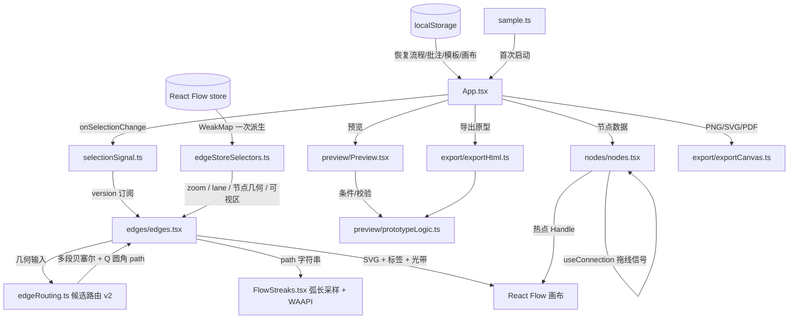

# FlowCraft 项目导航图

> 面向开发和维护的「找东西」索引。产品说明看 [README.md](./README.md)，四类主文档看 [docs/README.md](./docs/README.md)。
> 最后更新：2026-11-21

## 1. 项目速览

- 技术栈：React 19 + TypeScript + `@xyflow/react` + Vite
- 入口：`src/main.tsx` → `src/App.tsx`
- 数据：流程、批注、模板、画布与快照存 `localStorage`，JSON 导入/导出（`version: 3`，兼容 v1/v2 迁移）
- 开发：`npm run dev -- --port 5177`；构建 `npm run build`；测试 `npm test`（269/269）；检查 `npm run lint`
- Git：分支 `main`，远程 `origin`（github.com/applesiPad/flowcraft）

## 2. 目录与模块

```text
flowcraft/
├─ src/
│  ├─ main.tsx                 应用启动（刻意不启用 StrictMode）
│  ├─ App.tsx                  工作台：画布状态、快捷键、导入导出、面板接线（~2900 行，拆分见待办）
│  ├─ index.css                全局样式：编辑器、原型、画布/连线/面板（~4800 行）
│  └─ flow/
│     ├─ edges/                连线子系统
│     │  ├─ edgeRouting.ts       通用候选路由 v2：候选生成 + 线不穿卡不变式 + 打分 + Q 圆角
│     │  ├─ edges.tsx            FlowEdge（光晕/淡化/标签/光带）+ BezierConnectionLine（拖线预览 + 卡面命中）
│     │  ├─ FlowStreaks.tsx      彗尾流动光带（WAAPI，只在边「活」时挂载）
│     │  ├─ pathSample.ts        SVG path 纯 JS 弧长采样（不走 getTotalLength）
│     │  ├─ edgeColors.ts        语义配色单一来源（点=线=箭头同色）
│     │  ├─ edgeLabel.ts         标签尺寸估算、箭头 marker、lane 锚点
│     │  ├─ edgeStoreSelectors.ts 边共享派生状态（WeakMap 一帧全图一次派生）
│     │  ├─ selectionSignal.ts   选中信号（onSelectionChange 发布，边 O(1) 查询）
│     │  └─ EdgeLabelTitle.tsx   连线标签原地编辑（双击改触发文案）
│     ├─ nodes/                节点子系统
│     │  ├─ nodes.tsx            Screen / Decision / Action / Note 节点 + 拖线信号（data-drag）
│     │  ├─ InlineTitle.tsx      标题原地编辑组件（与 inlineTitle.ts 成对，注意大小写）
│     │  ├─ inlineTitle.ts       标题输入清洗纯函数
│     │  └─ elementEditor.ts     元素拖拽/缩放/吸附/容器钳制
│     ├─ preview/              原型预览与走查
│     │  ├─ Preview.tsx          全屏播放器（变量/校验/分支/动效）
│     │  ├─ ScreenView.tsx       画布内高保真界面渲染 + EditorContext（走查/排版/起线）
│     │  ├─ prototypeLogic.ts    条件求值/输入校验/跳转解析（预览与导出播放器共用）
│     │  └─ previewDebug.ts      预览调试面板：变量表 + 走查轨迹
│     ├─ export/               导出系列
│     │  ├─ exportCanvas.ts      PNG / SVG / PDF（动态 import，离屏全量渲染）
│     │  ├─ exportHtml.ts        单文件 HTML 原型（内嵌播放器 + 运行时求值）
│     │  ├─ exportReport.ts      评审报告（HTML，含界面/连线/判断/批注/体检）
│     │  ├─ exportGeometry.ts    节点尺寸与导出包围盒
│     │  ├─ exportLayout.ts      视口适配 / PDF 排版 / 文件名
│     │  ├─ exportFile.ts        JSON / 文本下载
│     │  └─ exportTypes.ts       导出选项与结果类型
│     ├─ templates/            模板体系
│     │  ├─ templateMarket.ts    校验、搜索、去重、Bundle 导入导出
│     │  ├─ templatePacks.ts     3 个内置行业模板包定义与实例化
│     │  └─ templateThumbnails.ts 模板/包 SVG 缩略图（纯函数，防注入）
│     ├─ Icon.tsx              13 类界面元素图标
│     ├─ Inspector.tsx         节点/连线/元素/条件/批注属性面板
│     ├─ Palette.tsx           模板市场面板（搜索/分类/缩略图/导入导出）
│     ├─ aiFlow.ts             AI 助手 MVP：文本 → 流程规划 → ScreenPack（接远程 LLM 只换 planFlowFromText）
│     ├─ alignDistribute.ts    多选对齐/等距分布纯几何
│     ├─ annotations.ts        批注数据模型与增删改
│     ├─ benchGraph.ts         性能基线合成大图（?bench=…）
│     ├─ canvasStore.ts        多画布存储与 legacy 迁移
│     ├─ flowHealth.ts         流程健康检查（四类缺陷 + 条件变量对账）
│     ├─ history.ts            增量撤销/重做快照
│     ├─ noteLayout.ts         备注锚定、旧档迁移、级联删除
│     ├─ qaProbe.ts            QA 探针 window.__fcQA
│     ├─ sample.ts             医院示例图 + 6 种内置界面模板
│     ├─ schemaMigrate.ts      Schema v1→v3 迁移链与导入校验
│     ├─ snapshotStore.ts      版本快照存储 + 结构化 diff
│     ├─ theme.ts              深浅主题与边框颜色
│     └─ types.ts              核心数据结构（含条件/校验/备注锚点）
├─ tests/                      24 个 Node 测试文件（node --test，导入需带 .ts 扩展名）
├─ docs/                       文档（四类主子结构，入口 docs/README.md）
├─ public/                     favicon 与图标资源
└─ vite.config.ts / tsconfig*.json / package.json
```

约定：`src/flow` 内部互引带 `.ts/.tsx` 扩展名（node --test 的 ESM 解析需要）；App.tsx 引 flow 模块不带扩展名（Vite）。`InlineTitle.tsx` 与 `inlineTitle.ts` 是 Windows 大小写不敏感文件系统上的同名对，**导入时必须写全扩展名**。

## 3. 运行时数据流



## 4. 核心功能索引

### 连线系统

| 你要找什么 | 文件 | 关键符号 |
| --- | --- | --- |
| 路由（候选生成/不变式/打分） | `src/flow/edges/edgeRouting.ts` | `computeEdgeEndpoints`、`generateCandidates`、`buildRouteChain`、`roundedStraightTail` |
| 边组件（光晕/淡化/标签/箭头） | `src/flow/edges/edges.tsx` | `FlowEdge`、`BezierConnectionLine` |
| 流动光带 | `src/flow/edges/FlowStreaks.tsx` | `FlowStreaks`、`pathSample.ts` 的 `measurePath` |
| 选中活性信号 | `src/flow/edges/selectionSignal.ts` | `publishSelection`、`selectionActive`、`selectionHasNode` |
| 语义配色 | `src/flow/edges/edgeColors.ts` | `handleColorOf`（yes/no/动词分类/稳定哈希） |
| 标签与箭头 | `src/flow/edges/edgeLabel.ts` | `estimateEdgeLabelSize`、`createArrowMarker`、`pointOnPolyline` |
| 共享派生状态 | `src/flow/edges/edgeStoreSelectors.ts` | `deriveEdgeFlowState`、`laneGroupForEdge`、`laneIndexOfEdge` |
| 连线标签原地编辑 | `src/flow/edges/EdgeLabelTitle.tsx` | `EdgeLabelTitle`（与 Inspector 同键合并撤销） |
| 拖线合法性 | `src/App.tsx` | `isValidConnection`、`onConnectEnd`（落卡兜底）、Strict 模式 |
| 设计与验收结论 | `docs/方案设计/连线系统设计.md` | —— |

### 节点与画布交互

| 你要找什么 | 文件 | 关键符号 |
| --- | --- | --- |
| 节点渲染 + 拖线信号 | `src/flow/nodes/nodes.tsx` | `ScreenNode`、`DecisionNode`、`ActionNode`、`NoteNode`、`useDragSignal`/`dragProps` |
| 标题原地编辑 | `src/flow/nodes/InlineTitle.tsx` + `inlineTitle.ts` | `InlineTitle`、`sanitizeTitleInput` |
| 元素拖拽/缩放/钳制 | `src/flow/nodes/elementEditor.ts` | `clampMoveBox`、`clampResizeBox`、`moveElementZ` |
| 画布内界面渲染与走查 | `src/flow/preview/ScreenView.tsx` | `EditorContext`、`ScreenView` |
| 多选对齐/分布 | `src/flow/alignDistribute.ts` | `applyAlignAction` |
| 备注锚定与迁移 | `src/flow/noteLayout.ts` | `noteAnchorFor`、`migrateLegacyNoteAnchors`、`cascadeDeleteNode` |
| 批注 | `src/flow/annotations.ts` + `src/flow/Inspector.tsx` | `createAnnotation`、`AnnotationPanel` |
| 撤销/重做 | `src/flow/history.ts` | 增量快照栈 |
| 深浅主题 | `src/flow/theme.ts` | 主题切换写 `data-theme` |

### 预览 / 原型逻辑

| 能力 | 文件 / 符号 |
| --- | --- |
| 全屏播放器 | `src/flow/preview/Preview.tsx`（变量表、校验拦截、分支 toast、动效） |
| 共享求值器 | `src/flow/preview/prototypeLogic.ts` / `evaluateCondition`、`pickDecisionHandle`、`validateInputValue` |
| 调试面板 | `src/flow/preview/previewDebug.ts`（变量表 + 走查轨迹） |
| 导出播放器（同语义） | `src/flow/export/exportHtml.ts` / `buildPrototypeHtml` |

### 面板 / 模板 / AI

| 能力 | 文件 / 符号 |
| --- | --- |
| 属性面板 | `src/flow/Inspector.tsx`（节点/连线/元素/条件/批注） |
| 模板市场 | `src/flow/Palette.tsx` + `src/flow/templates/templateMarket.ts`（`filterTemplates`、`mergeTemplates`、`buildTemplateBundle`） |
| 行业模板包 | `src/flow/templates/templatePacks.ts`（`screenPacks`、`buildPackGraph`） |
| 缩略图 | `src/flow/templates/templateThumbnails.ts`（纯函数 SVG） |
| AI 助手 | `src/flow/aiFlow.ts`（`planFlowFromText`、`buildAiPack`、`findBlankAnchor`、`suggestWires`） |
| 图标 | `src/flow/Icon.tsx` |

### 平台能力（多画布 / 快照 / 体检 / 导出）

| 能力 | 文件 / 符号 |
| --- | --- |
| 多画布存储 | `src/flow/canvasStore.ts` / `ensureCanvases`、`readCanvasData`、`writeCanvasData` |
| 画布操作 | `src/App.tsx` / `switchCanvas`、`createCanvas`、`duplicateCanvas`、`deleteCanvas` |
| 快照与对比 | `src/flow/snapshotStore.ts` / `addSnapshot`（≤30）、`diffFlows` |
| 健康检查 | `src/flow/flowHealth.ts` / `scanFlowHealth`（四类缺陷 + 条件变量对账） |
| PNG/SVG/PDF | `src/flow/export/exportCanvas.ts`（`withFullRender` 导出保护在 App.tsx） |
| 单文件 HTML 原型 | `src/flow/export/exportHtml.ts` |
| 评审报告 | `src/flow/export/exportReport.ts` |
| JSON 导入导出 | `src/flow/export/exportFile.ts` + `src/flow/schemaMigrate.ts`（v1→v3） |
| QA 探针 | `src/flow/qaProbe.ts`（`window.__fcQA`） |
| 性能基线图 | `src/flow/benchGraph.ts`（`?bench=medium&cull=1`） |

## 5. 数据与存储

| 存储键 | 内容 |
| --- | --- |
| `flowcraft.flow.v1` | `{ nodes, edges, annotations }`；备注节点可带 `data.anchor = { nodeId, side, gap }` |
| `flowcraft.templates.v1` | 自定义模板数组 |
| `flowcraft.annotations.v1` | 批注数组 |
| `flowcraft.cull.v1` | 可视区裁剪开关（缺省开） |
| `flowcraft.canvases.v1` / `flowcraft.canvas.active.v1` / `flowcraft.canvas.data.<id>.v1` | 画布列表 / 活动 id / 非活动数据 |
| `flowcraft.snapshots.<canvasId>.v1` | 快照（≤30 条） |

流程 JSON 导出 `{ version: 3, nodes, edges, annotations }`；导入端 v1/v2 经 `schemaMigrate.ts` 自动迁移。

## 6. 常用修改入口

- 连线外观 / 拖线反馈 / 光带：`src/flow/edges/edges.tsx` + `src/flow/edges/FlowStreaks.tsx` + `src/index.css`（搜 `fc-edge` / `data-drag`）
- 连线路由与避障：`src/flow/edges/edgeRouting.ts`（设计依据见 docs/方案设计/连线系统设计.md）
- 连线颜色：`src/flow/edges/edgeColors.ts`（点=线=箭头一处改）
- 节点样式 / 拖线信号：`src/flow/nodes/nodes.tsx` + `src/index.css`
- 界面元素渲染 / 走查：`src/flow/preview/ScreenView.tsx`、`src/flow/Icon.tsx`
- 原型逻辑（条件/校验）：`src/flow/preview/prototypeLogic.ts`
- 属性面板：`src/flow/Inspector.tsx`
- 模板市场：`src/flow/templates/*` + `src/flow/Palette.tsx`
- 导出：`src/flow/export/*`
- 工具栏 / 快捷键 / 画布接线：`src/App.tsx`
- 持久化结构：`src/flow/types.ts` + `src/flow/schemaMigrate.ts`

## 7. 验证清单

```powershell
npm test          # 269 个测试：路由性质、标签、光带采样、选中信号、对齐分布、批注、模板、原型逻辑、
                  # 备注、元素编辑器、导出布局、schema 迁移、预览调试、评审报告、QA 探针等
npm run lint      # Oxlint
npm run build     # TypeScript + Vite 生产构建
npm run dev -- --port 5177
```

浏览器回归的自动化限制与可靠做法见 [docs/质量与验收/验收方法论.md](./docs/质量与验收/验收方法论.md)；手工回归重点：

1. 拖动节点时连线实时重算、不穿卡；回边走专用候选。
2. 选中节点：相连边亮光晕 + 光带流动，其余连线淡到 0.22；取消选中还原。
3. 拖线到目标卡任意位置：预览转拖线色实线；入口点半径内点放大转色、整卡亮外圈；松手落卡建线。
4. 双击连线标签原地改文案；双击标题改名；Esc/空文案回退。
5. 窄屏 940/620 抽屉开合无溢出、无残留遮罩。
6. PNG/SVG/PDF/单文件 HTML 导出均可用（裁剪开启时导出自动全量渲染）。
