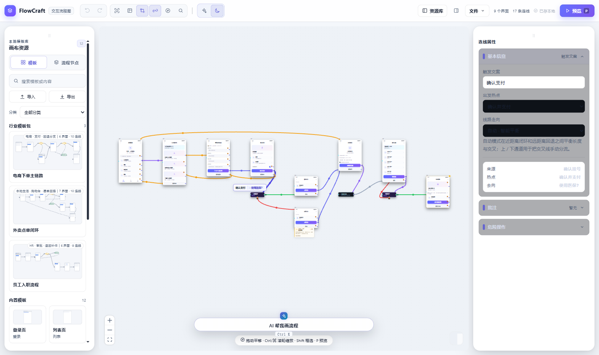
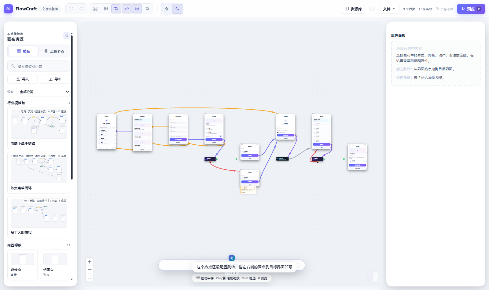
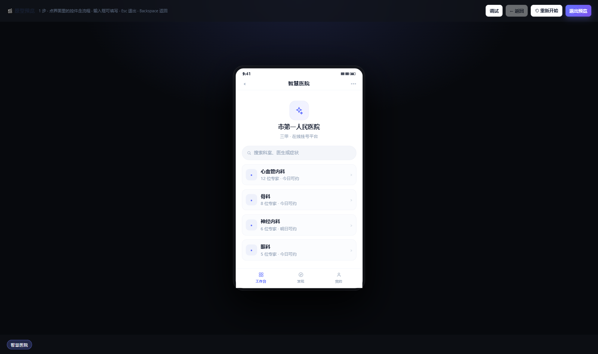

# FlowCraft · 软件交互流程图

**画布即原型**：流程图里的每个节点是一块用 React 组件渲染的**真实界面**（状态栏、导航栏、列表、卡片、按钮、输入框……），界面里的按钮本身就是连线锚点——把「确认支付」按钮拖到下一个界面，一条带触发文案的跳转连线就建好了。按 `P`，像真机一样点着走完整个流程；导出单个 HTML 文件，发给产品或客户双击就能点。

**为交互流程图而生，不是通用画图工具**。连线有语义（哪个按钮 → 跳到哪个界面）、判断节点带是/否分支、预览自动穿透动作节点；配上条件求值与输入校验，原型不只是演示，还能真的「填手机号 → 校验失败拦截 → 走对分支」。AI 输入条（Ctrl/⌘+K）用一句话生成一段流程，锚定插入到当前卡片旁边。





## 运行

```powershell
npm install
npm run dev -- --port 5177          # 开发：http://127.0.0.1:5177/
# 独立示例（不覆盖本地画布）：http://127.0.0.1:5177/?example=ecommerce
# 性能基线压测入口（不读写本地存档）：http://127.0.0.1:5177/?bench=medium&cull=1
npm test                            # 262 个 Node 测试
npm run lint                        # Oxlint
npm run build                       # TypeScript + Vite 生产构建
npm start                           # 生产构建 + 预览：http://127.0.0.1:5178/
```

项目模块、数据流和快速查找入口见 [GRAPH.md](./GRAPH.md)。

> 如果画布里的连线集体不显示，是 Vite 预打包缓存里留了旧 React 副本（表现为 handle 和边状态都在、但画不出来）：删除 `node_modules/.vite` 后重启 dev，并**硬刷新**页面或换一个端口打开。本项目实测过两次该现象与恢复方式；生产构建不受影响。

## 已实现并逐项验证

| 能力 | 说明 | 验证结果 |
| --- | --- | --- |
| 界面节点 | 6 种高保真手机界面模板，13 类界面元素 | 画布渲染 6 个界面 / 9 个节点 |
| 备注锚定 | 备注是矩形说明卡，绑定目标界面并随其移动；旧存档自动迁移，删除目标时同步清理 | 现行 262 项测试全套通过（含备注布局、连线标签与回边路由回归）；Ego 实测目标与备注左对齐、间距 28px |
| 响应式工作台 | 桌面三栏；940px 以下资源库/属性改为抽屉，620px 以下保留图标入口 | Ego 在 1470 / 1180 / 900 / 620 实测无横向溢出，抽屉可开可关 |
| 热点锚点 | 每个界面元素一个独立 Handle（id = 元素 id） | 34 个 `react-flow__handle` |
| 跳转连线 | 热点 → 目标界面，自动生成标签「点击「X」」 | 12 条连线 / 12 个标签 |
| 连线避障与回边分流 | 直线穿过节点时用正交 A* 路由绕开；远距离回退保持最短避障，近距离上下闭环走局部下通道，减少主流程交叉 | 现行 262 项测试全套通过；Ego 电商示例总路径长度 11832.71，交叉 1 组（旧全局底部方案 15423.73 / 3 组） |
| 连线标签归属 | 默认只保留连线的方向箭头，选中连线后才显示文字标签和 `→ 目标界面` chip，降低多线画布噪声 | 现行 262 项测试全套通过；Ego 三档宽度 × 深浅主题验收：默认 0 个文字标签，方向箭头保留 |
| 可视区裁剪 | 默认只渲染窗口内的节点与连线，工具栏可切换并记住偏好；导出/打印前自动临时全量渲染 | 30/100/200 节点基线实测：100 节点拖拽 longtask 从 2.3–11.4s 归零、fps 2→59；200 节点挂载 25.2s→2.8s（[基线记录](./docs/perf-baseline-2026-11-01.md)） |
| 连线二次编辑 | 选中连线后可修改触发文案（右栏输入框或**双击画布标签原地改**）、出发热点，并在自动 / 上通道 / 下通道之间切换；支持撤销 | Ego 实测 `submit → send` 热点切换、路径重算与撤销恢复；手动上通道路径立即生效 |
| 路由缓存 | 有界 LRU（默认 2048 条），缓存键覆盖端点、节点几何、排除节点和边距；同一几何数组实例只序列化一次 | 9 个缓存/路由键测试通过 |
| 边标签共享派生状态 | `FlowEdge` 的 zoom / lane 分组 / 对端标签尺寸 / 全量节点几何 / 可视区改为按 store 对象 WeakMap 记忆，一次更新内全图只派生一次，替代每条边各自的 O(E)+O(N) 扫描 | 9 项 `edgeStoreSelectors` 测试证明与旧逐边语义逐值等价；200 节点 / 240 边确定性微基准每帧派生 2.68ms → 0.06ms（≈43×）；Ego A/B：电商示例 14 条边的路径 d 校验和、总长 11834.31、交叉 1 组与全部标签 lane/屏幕矩形逐字节一致 |
| 条件分支 | 判断节点：是（右）/ 否（下）两条出口，独立标签 | 「是 / 否」标签画布可见 |
| 显式建连线 | 选中界面 → 右侧属性面板「建立跳转」两个下拉 + 按钮 | 实测 12 → 13 条，标签自动生成 |
| 连线合法性 | Strict 模式：只允许从热点 / 分支 / 出口锚点起线，连到界面的入口锚点 / 判断 / 动作节点；热点对热点、入口反向起线都会被拒绝并提示 | `ConnectionMode.Strict` + `isValidConnection` + Toast 提示 |
| 元素自由排版 | 选中界面后直接拖界面里的元素，或改属性面板的 X / Y / 宽；「恢复竖排布局」一键还原 | 拖动后写入 `box` + `layout:"free"`，刷新与导出都保留 |
| 元素缩放 / 吸附 / 层级 | 选中界面后元素显示 8 方向缩放把手，拖动提供对齐参考线；属性面板支持上移、下移、置顶、置底 | 25 项元素编辑器测试；Ego 实测 `e` 把手宽度 297.97px → 387.57px，释放后参考线清空 |
| 走查模式 | 点热点 → 镜头飞到目标界面并高亮（琥珀描边），未配置跳转的热点会提示怎么连 | 点「点单小程序」→ 高亮 + 飞行到「项目详情」，Toast「走查：项目详情」 |
| 原型预览 | 点热点真实走流程，自动穿过判断/动作节点，面包屑 + 返回 + 重来 | 登录 → 工作台 → 项目详情 → 确认支付 → 支付成功 |
| 导出单文件原型 | 把当前流程图导出成一个可直接双击打开的 HTML（内联 CSS + 原生 JS 播放器，含面包屑 / 返回 / 重来 / Backspace / Esc / 页面切换动效） | 48 KB 单文件，6 个界面 / 9 条跳转，`file://` 与 http 下点通三跳：登录 → 工作台 → 项目详情 |
| 多画布管理 | 顶栏画布切换器：新建 / 切换 / 重命名 / 复制 / 删除（两步确认）；旧存档自动登记为默认画布，`flowcraft.flow.v1` 始终是活动画布的镜像，切换前自动存快照 | Ego round8 22/22 PASS：新建画布内容隔离（0 节点 vs 样例 12）、切回数据完整、重命名/复制/删除生效、localStorage 迁移零拷贝 |
| 版本快照与对比 | 每画布最多 30 份快照（手动 + 自动）；任意快照与当前画布结构化对比：新增/删除界面、改名、连线增删、元素修改、条件与批注变化；恢复前自动存快照可回退 | Ego round8：加节点后对比正确列出「新增界面」，恢复后回到基线 12 节点，自动快照带标记且计数正确 |
| 流程健康检查 | 一键扫描四类流程缺陷：未接线主按钮（primary 按钮无出口）、判断分支不全、死路界面（无出口）、孤立界面（无入无出）；点击问题项定位到节点 | Ego round8：样例图准确扫出 2 项（订单追踪未接线主按钮 + 收货信息死路），点击后节点被选中定位 |
| 原型逻辑（条件 / 校验 / 变量） | 预览与导出播放器共用同一求值器（`prototypeLogic.ts`）：输入框可绑定变量名与校验规则（必填 / 手机号 / 数字），判断节点可配条件（数值 / 字符串比较、空判），原型运行时按变量自动选是/否分支；输入框可填写并参与校验，失败拦截并描红，切换带方向动效 | 现行 262 项测试全套通过（含求值器真值表 / 分支解析 / 校验规则）；Ego round7 42/42 PASS：应用内预览与导出播放器的分支、拦截、动效、输入回填逐项一致，播放器内嵌求值器与 TS 真值表逐值相同 |
| PNG / SVG / PDF 导出 | 整图导出；PNG 高清位图，SVG 矢量，PDF 为 A3 横向单页 | Ego 实测 PNG 654,019 B / 3840×1546；SVG 3,308,814 B 且 XML 可解析；PDF 416,754 B 且结构完整 |
| 批注 | 节点/连线批注，支持增删改、颜色、空态、确认删除，随 JSON 导出并本地持久化 | Ego 实测新增、编辑、改色、刷新恢复、连线批注、删除、JSON 导出 |
| 模板市场 | 内置 + 自定义模板；搜索、分类、保存、导入、导出、去重、非法文件提示 | Ego 实测保存后 6 → 7；重复导入仍为 1；非法 JSON 数据不变 |
| 模板预览缩略图 | 内置模板与行业模板包投影为自包含 SVG 迷你界面（纯函数、无 DOM 依赖；用户自定义模板不进 SVG，防注入） | Ego 实测调色板 6 张内置缩略图 + 3 个模板包卡片；搜索「外卖」过滤为 1 包 |
| 内置行业模板包 | 3 个「一整条业务链路」的本地包（电商下单 / 外卖点单 / 员工入职），点击居中插入或拖入画布，一次快照整体可撤销 | Ego 实测点击插入 12/14 → 21/24 节点/边，一次撤销回到 12/14；拖入 HR 包 20/22，撤销恢复 |
| 自动布局 | DFS 去回边 + 最长路径分层，能正确处理「返回 / 退出」造成的环 | 环图（登录→判断→工作台→…→登录）一键整理后 12 条连线仍全部正常 |
| 原地编辑 | 双击画布直接改名：界面导航栏 / 判断问题 / 动作名称 / **连线触发文案**四处；Enter/失焦提交、Esc 取消、空文案回退，与属性面板同键合并为一步撤销 | Ego 26 项：三处节点标题 + 连线标签的全链路（进入/提交/同步/撤销/重做/Esc/空回退）PASS |
| 多选对齐 / 等距分布 | 多选 ≥2 浮现 Figma 式工具条（8 键：左中右、上中下、水平垂直分布）；对齐取选中集包围盒，分布=等间隙、首尾不动；一条撤销 | 11 项几何测试 + Ego 六场景（浮现/禁用态/对齐+撤销/分布/无操作）PASS |
| 药丸起线 + 死路角标 | 判断节点「是/否」药丸点击起线、点目标卡完成两次点击连线；死路界面画布橙描边 + 角标（未接线主按钮数/「无出口」），接线即时消失 | 3 项 deadHints 测试 + Ego 5/5 PASS |
| AI 输入条 | 画布底部常驻胶囊，Ctrl/⌘+K 唤起；Enter 生成预览，选中界面/判断时锚定插入到该卡旁；AI 面板支持拖拽、选中卡片上下文条、以此为起点续写 | Ego 13/13（唤起/生成/锚定插入/撤销/双主题/窄屏隐藏）PASS |
| 撤销 / 重做 | 增量变更栈，Ctrl+Z / Ctrl+Shift+Z | 加节点 9 → 10，Ctrl+Z 回到 9 |
| 本地持久化 | localStorage `flowcraft.flow.v1`、`flowcraft.annotations.v1`、`flowcraft.templates.v1` | 刷新后界面、连线、自由排版、批注、模板完整恢复 |
| 导入 / 导出 JSON | 文件导入导出，可纳入版本管理；当前导出 `version: 3`（v1/v2 旧档导入时自动迁移并逐条提示） | 工具栏「导出 / 导入 ▾」菜单 |
| 打印 / PDF | 先按 A3 横向比例整图缩放，再调系统打印，可另存 PDF；工具栏也提供直接 PDF 导出 | `window.print()` 实测触发；直接 PDF 导出通过 |
| 键盘 | `P` 预览、`Space` 平移、`Ctrl+S` 保存、`Ctrl+D` 复制、`Delete` 删除 | 均已接线 |

## 交互手势（对齐 Figma / Whimsical 习惯）

- **拖空白** = 平移画布；**滚轮** = 上下平移；**Ctrl/⌘ + 滚轮** = 缩放；**空格 + 拖** / **中键拖** = 平移；**Shift + 拖** = 框选
- **双击空白** = 新建一个列表页界面（不再触发缩放）
- **拖热点右侧圆点** 到目标界面 = 建立跳转（最接近 Figma / Protopie 的手感）
- **选中界面** → 直接拖动界面里的元素自由排版；8 方向把手缩放并显示对齐参考线；右侧属性面板可改标题、X/Y/宽、增删元素、层级与热点
- **🔎 走查** → 像真实用户一样点界面里的控件，镜头自动飞到它连着的那个界面
- **选中连线** → 改触发文案（双击标签原地改或右栏输入）、换出发热点、切换自动/上/下线路走向、删除
- **选中节点标题 / 连线标签** → 双击直接改名（Esc 取消、空文案回退）
- **多选 ≥2** → 画布顶部浮现对齐 / 等距分布工具条
- **判断节点** → 点「是 / 否」药丸起线，再点目标卡完成连线
- **选中节点/连线** → 右侧属性面板添加、编辑、改色或删除批注
- **备注卡片** → 在属性面板选择关联界面与放置方向（右侧 / 底部），卡片会随目标移动
- **窄屏（≤940px）** → 顶栏「资源库」和右侧面板图标打开抽屉，按 `Esc` 或点遮罩关闭
- `P` = 进入原型预览，`Esc` = 退出

## 数据模型

```ts
type FlowNode = ScreenNode | DecisionNode | ActionNode | NoteNode
ScreenNode = { id, type: 'screen', data: { title, elements: ScreenElement[], layout?: 'stack' | 'free' } }
ScreenElement = { id, kind, label, hotspot?: boolean, box?: { x, y, w, h? } }   // kind：13 种界面元素
FlowEdge = { id, source, sourceHandle: 元素id, target, targetHandle: 'in', label }
Annotation = { id, targetType: 'node' | 'edge', targetId, content, color, createdAt, updatedAt }
```

连线用 `sourceHandle = 元素 id`，因此**一个界面可以有多条不同出口**（登录按钮去首页、注册链接去注册页、忘记密码去找回页）——这正是普通流程图库做不到、而交互流程图必须要的部分。`layout: 'free'` 时每个元素用屏幕本地 px 的 `box` 绝对定位，第一次拖动时把竖排布局量成绝对坐标冻结下来，所以「自由排版」不会破坏已有模板。

## 数据与导出

| 存储键 / 格式 | 内容 |
| --- | --- |
| `flowcraft.flow.v1` | 活动画布的 `{ nodes, edges, annotations }`（镜像） |
| `flowcraft.annotations.v1` | 活动画布的批注数组 |
| `flowcraft.templates.v1` | 自定义模板数组 |
| `flowcraft.canvases.v1` | 画布列表 `[{ id, name, createdAt, updatedAt }]` |
| `flowcraft.canvas.active.v1` | 活动画布 id |
| `flowcraft.canvas.data.<id>.v1` | 非活动画布数据 |
| `flowcraft.snapshots.<canvasId>.v1` | 画布快照（≤30 条） |
| 流程 JSON | `{ version: 3, nodes, edges, annotations }`（导入端兼容 v1/v2 自动迁移） |
| 模板 Bundle | `{ version: 1, exportedAt, templates }` |

## 和 infinite-canvas 的关系

没有 fork 它。依据在 `../docs/01-开源方案对比.md` 里有源码级证据：它的连线是硬编码的「右侧中点 → 左侧中点」三次贝塞尔，没有端口 id、没有标签、没有箭头，`CanvasConnection` 只有 `{id, fromNodeId, toNodeId}` 三个字段（`web/src/types/canvas.ts:100-104`），插件 SDK 也只作用于节点层。而交互流程图的核心恰恰是**连线层语义**（哪个按钮 → 跳到哪个界面）。所以这里只借鉴它的产品直觉（节点内渲染真实 UI、无限画布手感），底座换成 `@xyflow/react`（MIT）——多 Handle、`EdgeLabelRenderer`、`markerEnd` 都是现成的。

各家开源方案的交互范式逐项拆解与取舍，见 `../docs/02-交互与UI设计对照.md`（Figma/FigJam、ProtoPie、Framer、wireflow、AntV X6、maxGraph/draw.io、Excalidraw、infinite-canvas 八家的连线建法、标签分支、预览能力对照表）。

## 已知限制

- 界面元素是预置的 13 种；已支持移动、缩放、吸附和层级，但还不是任意自定义组件编辑器。拖拽与缩放会把元素钳制在屏幕容器内：横向不越 `overflow: hidden` 边界（把手不再被裁掉），纵向自由布局高度随内容增长不受限；属性面板 X/Y/宽 数字输入同样受钳制
- 没有协作 / 云端存储，靠 localStorage + JSON 文件；画布上限 20 个、每画布快照上限 30 条
- 备注目前支持右侧 / 底部两种锚定方向；复杂避让仍由用户手动调整其他节点
- 模板市场当前是**本地模板库**：内置模板与行业模板包带 SVG 预览缩略图，但没有账号体系、远程分发或服务端审核
- 性能优化已做有界路由缓存、导出动态拆包与可视区裁剪（默认开，基线见 [docs/perf-baseline-2026-11-01.md](./docs/perf-baseline-2026-11-01.md)）；自动回边是几何启发式平衡，不是全局全图最优路由
- 可视区裁剪开启时，全图 fitView 视角没有 DOM 收益，medium 级图挂载会慢约 3s；导出/打印依赖 `withFullRender` 临时全量渲染，超大图导出仍受浏览器画布上限约束
- 导出的单文件原型带条件求值、输入校验与切换动效，但仍是**前端演示快照**：没有真实提交、存储或服务端逻辑；条件只支持单变量比较，不支持跨变量组合表达式
- Shift 框选 / Shift 加选依赖真实键盘事件，自动化脚本无法验证，需人工鼠标确认
- PNG / SVG / PDF 导出依赖浏览器 DOM 捕获；超大画布受浏览器画布尺寸上限约束

## 明确不做

- P0-2 垂直布局
- 云端同步（当前没有云盘）
- 多人实时编辑
- 第三方评论

## 下一步建议（按性价比排序）

1. ~~若确需协作，单独设计后端、权限与冲突合并~~ ✅ 设计已产出：[docs/协作方案设计.md](./docs/协作方案设计.md)（仅设计，不实现）
2. ~~JSON 导入时增加显式 schema 版本迁移与错误详情~~ ✅ 已完成：`src/flow/schemaMigrate.ts`（v1→v3 显式迁移链 + 逐条 ImportIssue + 未来版本拒绝）
3. ~~连线标签原地编辑~~ ✅ 已完成（2026-11-07，见上表「原地编辑」）

已完成（2026-11-01）：`FlowEdge` lane/peer 预分组与共享派生状态、边路由 LRU 扩容至 2048（见上表「边标签共享派生状态」）。
已完成（2026-11-02）：模板预览缩略图 + 内置行业模板包；原型逻辑（条件求值 + 输入校验 + 切换动效）；多画布管理；版本快照与对比；流程健康检查（均见上表）。
已完成（2026-11-04）：§8 性价比清单冲刺——AI 常驻输入条、判断药丸点击起线 + 死路角标、节点标题原地编辑、多选对齐/等距分布（均见上表）。
已完成（2026-11-07）：连线标签原地编辑收尾；窄屏（≤940px）sheet 布局 display 级联 bug 修复（1440–320 五档实测）；连线模式收紧为 Strict 并补入口反向起线拦截。


