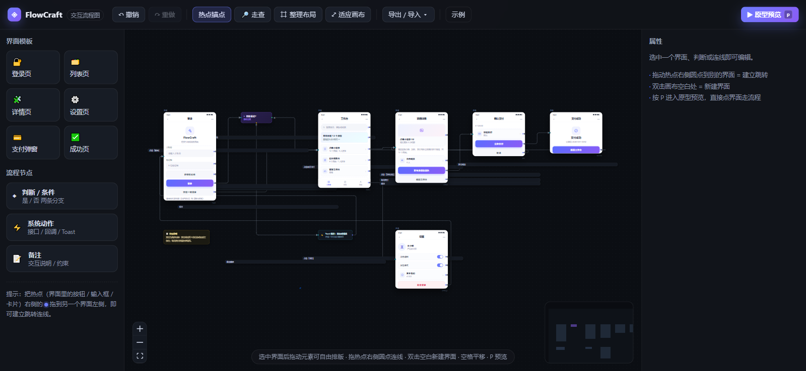
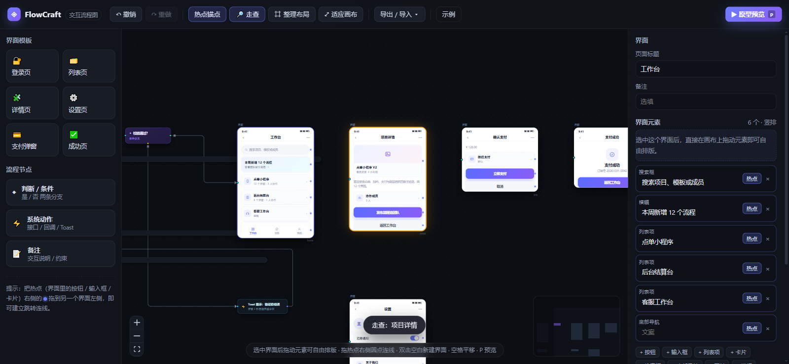
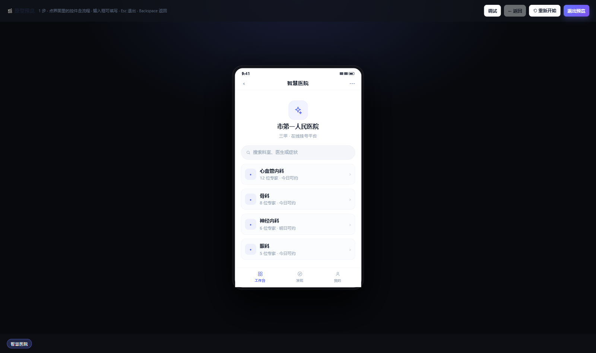

# FlowCraft · 软件交互流程图

**画布即原型**：流程图里的每个节点是一块用 React 组件渲染的**真实界面**（状态栏、导航栏、列表、卡片、按钮、输入框……），界面里的按钮本身就是连线锚点——把「确认支付」按钮拖到下一个界面，一条带触发文案的跳转连线就建好了。按 `P`，像真机一样点着走完整个流程；导出单个 HTML 文件，发给产品或客户双击就能点。

**为交互流程图而生，不是通用画图工具**。连线有语义（哪个按钮 → 跳到哪个界面）、判断节点带是/否分支、预览自动穿透动作节点；配上条件求值与输入校验，原型不只是演示，还能真的「填手机号 → 校验失败拦截 → 走对分支」。AI 输入条（Ctrl/⌘+K）用一句话生成一段流程，锚定插入到当前卡片旁边。





## 运行

```powershell
npm install
npm run dev -- --port 5177          # 开发：http://127.0.0.1:5177/
# 独立示例（不覆盖本地画布）：http://127.0.0.1:5177/?example=ecommerce
# 性能基线压测入口（不读写本地存档）：http://127.0.0.1:5177/?bench=medium&cull=1
npm test                            # Node 测试（当前 269 项）
npm run lint                        # Oxlint
npm run build                       # TypeScript + Vite 生产构建
npm start                           # 生产构建 + 预览：http://127.0.0.1:5178/
```

> 如果画布里的连线集体不显示，是 Vite 预打包缓存里留了旧 React 副本（表现为 handle 和边状态都在、但画不出来）：删除 `node_modules/.vite` 后重启 dev，并**硬刷新**页面或换一个端口打开。本项目实测过两次该现象与恢复方式；生产构建不受影响。

## 文档地图

| 你想看什么 | 去哪 |
| --- | --- |
| 全部功能与验证证据 | [docs/功能清单.md](./docs/功能清单.md) |
| 设计取舍（为什么这么做） | [docs/方案设计/](./docs/方案设计/)（开源对比 / 八家交互对照 / 连线系统设计 / 协作方案等） |
| 每轮交付了什么（时间线 + 提交号） | [docs/变更记录.md](./docs/变更记录.md)，细节在 [docs/变更详情/](./docs/变更详情/) |
| 现在还欠什么、明确不做什么 | [docs/任务与待办.md](./docs/任务与待办.md) |
| 模块结构 / 数据流 / 按功能找文件 | [GRAPH.md](./GRAPH.md) |
| E2E 自动化的限制与可靠做法 | [docs/质量与验收/验收方法论.md](./docs/质量与验收/验收方法论.md) |

## 交互手势（对齐 Figma / Whimsical 习惯）

- **拖空白** = 平移画布；**滚轮** = 上下平移；**Ctrl/⌘ + 滚轮** = 缩放；**空格 + 拖** / **中键拖** = 平移；**Shift + 拖** = 框选
- **双击空白** = 新建一个列表页界面（不再触发缩放）
- **拖热点右侧圆点** 到目标界面 = 建立跳转；拖到目标卡**任意位置**也能落线（预览转实线）
- **选中界面** → 直接拖动界面里的元素自由排版；8 方向把手缩放并显示对齐参考线；右侧属性面板可改标题、X/Y/宽、增删元素、层级与热点
- **🔎 走查** → 像真实用户一样点界面里的控件，镜头自动飞到它连着的那个界面
- **选中连线** → 改触发文案（双击标签原地改或右栏输入）、换出发热点、切换自动/上/下线路走向、删除
- **选中节点标题 / 连线标签** → 双击直接改名（Esc 取消、空文案回退）
- **多选 ≥2** → 画布顶部浮现对齐 / 等距分布工具条
- **判断节点** → 点「是 / 否」药丸起线，再点目标卡完成连线
- **选中节点/连线** → 右侧属性面板添加、编辑、改色或删除批注
- **备注卡片** → 在属性面板选择关联界面与放置方向（右侧 / 底部），卡片会随目标移动
- **窄屏（≤940px）** → 顶栏「资源库」和右侧面板图标打开抽屉，按 `Esc` 或点遮罩关闭
- `P` = 进入原型预览，`Esc` = 退出

## 数据模型

```ts
type FlowNode = ScreenNode | DecisionNode | ActionNode | NoteNode
ScreenNode = { id, type: 'screen', data: { title, elements: ScreenElement[], layout?: 'stack' | 'free' } }
ScreenElement = { id, kind, label, hotspot?: boolean, box?: { x, y, w, h? } }   // kind：13 种界面元素
FlowEdge = { id, source, sourceHandle: 元素id, target, targetHandle: 'in', label }
Annotation = { id, targetType: 'node' | 'edge', targetId, content, color, createdAt, updatedAt }
```

连线用 `sourceHandle = 元素 id`，因此**一个界面可以有多条不同出口**（登录按钮去首页、注册链接去注册页、忘记密码去找回页）——这正是普通流程图库做不到、而交互流程图必须要的部分。`layout: 'free'` 时每个元素用屏幕本地 px 的 `box` 绝对定位，第一次拖动时把竖排布局量成绝对坐标冻结下来，所以「自由排版」不会破坏已有模板。

## 数据与导出

| 存储键 / 格式 | 内容 |
| --- | --- |
| `flowcraft.flow.v1` | 活动画布的 `{ nodes, edges, annotations }`（镜像） |
| `flowcraft.annotations.v1` | 活动画布的批注数组 |
| `flowcraft.templates.v1` | 自定义模板数组 |
| `flowcraft.canvases.v1` | 画布列表 `[{ id, name, createdAt, updatedAt }]` |
| `flowcraft.canvas.active.v1` | 活动画布 id |
| `flowcraft.canvas.data.<id>.v1` | 非活动画布数据 |
| `flowcraft.snapshots.<canvasId>.v1` | 画布快照（≤30 条） |
| 流程 JSON | `{ version: 3, nodes, edges, annotations }`（导入端兼容 v1/v2 自动迁移） |
| 模板 Bundle | `{ version: 1, exportedAt, templates }` |

## 和 infinite-canvas 的关系

没有 fork 它——它的连线是硬编码的「右中点 → 左中点」贝塞尔，没有端口 id、没有标签，而交互流程图的核心恰恰是**连线层语义**。所以这里只借鉴它的产品直觉（节点内渲染真实 UI、无限画布手感），底座换成 `@xyflow/react`（MIT）。源码级证据与八家开源方案的交互范式拆解见 [docs/方案设计/01-开源方案对比.md](./docs/方案设计/01-开源方案对比.md) 与 [docs/方案设计/02-交互与UI设计对照.md](./docs/方案设计/02-交互与UI设计对照.md)。

## 已知限制

- 界面元素是预置的 13 种；已支持移动、缩放、吸附和层级，但还不是任意自定义组件编辑器。拖拽与缩放会把元素钳制在屏幕容器内（横向不越 `overflow: hidden` 边界，纵向自由布局高度随内容增长）；属性面板 X/Y/宽 同样受钳制
- 没有协作 / 云端存储，靠 localStorage + JSON 文件；画布上限 20 个、每画布快照上限 30 条
- 备注目前支持右侧 / 底部两种锚定方向；复杂避让仍由用户手动调整其他节点
- 模板市场是本地模板库：带 SVG 预览缩略图，但没有账号体系、远程分发或服务端审核
- 性能优化：有界路由缓存已随连线 v2 移除（纯几何计算）、导出动态拆包与可视区裁剪（默认开，基线数字见 [docs/变更详情/原始交付记录-2026-10-31_11-21.md](./docs/变更详情/原始交付记录-2026-10-31_11-21.md) 2026-11-01 小节）；自动回边是几何启发式平衡，不是全局全图最优路由
- 可视区裁剪开启时，全图 fitView 视角没有 DOM 收益，medium 级图挂载会慢约 3s；导出/打印依赖 `withFullRender` 临时全量渲染，超大图导出仍受浏览器画布上限约束
- 导出的单文件原型带条件求值、输入校验与切换动效，但仍是**前端演示快照**：没有真实提交、存储或服务端逻辑；条件只支持单变量比较，不支持跨变量组合表达式
- Shift 框选 / Shift 加选依赖真实键盘事件，自动化脚本无法验证，需人工鼠标确认
- PNG / SVG / PDF 导出依赖浏览器 DOM 捕获；超大画布受浏览器画布尺寸上限约束

明确不做清单与待办见 [docs/任务与待办.md](./docs/任务与待办.md)。
